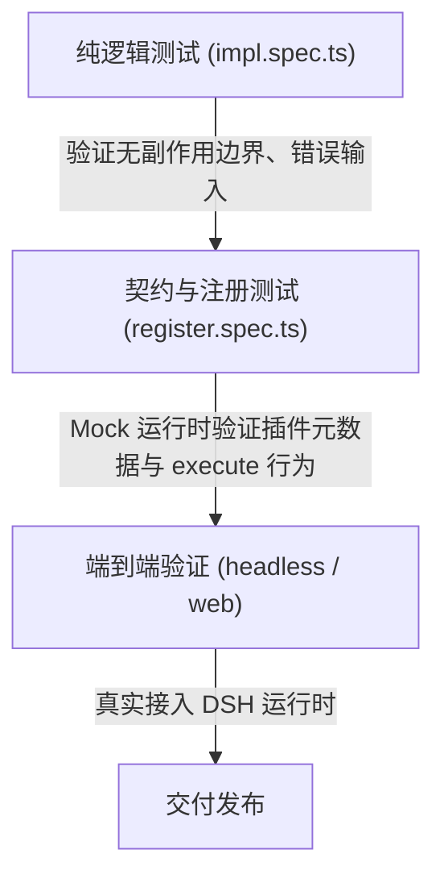

# DSH 插件开发通用指南（从零起手）

> 本指南结合 **DSH（DeepSeek Harness）微内核架构**、工具插件开发实践与服务端/全栈前端插件实测经验整理而成。旨在提供一份**开箱即用、覆盖后端工具/服务扩展/前端 UI 注入**的通用起手开发手册。

---

## 0. 核心架构认知（3 分钟理解 DSH）

DSH 采用基于 **Cordis** 的微内核架构 —— **「一切皆插件」**。模型交互、会话持久化、命令行、Web 启动器、甚至 Agent 循环本身都是插件。

### 0.1 核心三要素

| 概念 | 含义 | 形式与定位 |
|---|---|---|
| **插件（Plugin）** | 运行时执行单元 | 导出 `name`、`inject`、`apply(ctx)` 的 ESM 模块。通过上下文 `ctx` 注册能力与监听事件。 |
| **组合包（Bundle）** | 插件的分发与组装单元 | 一个 npm 包 + 一张 `cordis.patch.yml`。`package.json` 中声明 `dsh.bundle.patch`。 |
| **配置集（Profile）** | 运行时的装配环境 | 位于 `~/.dsh/profiles/<name>/`。例如 `web`（带 Web UI）与 `headless`（无头批处理/任务执行）。 |

### 0.2 插件的三种业务形态选型

1. **工具插件（Tool Plugin）**：向模型注册新工具能力（零依赖纯函数、系统工具、编码转换）。
2. **服务端扩展/服务插件（Service/Middleware Plugin）**：注册 HTTP 路由、提供中间件、提供 `ctx.provide` 服务或**替换官方原生插件**。
3. **前端 UI 插件（Browser Half Plugin）**：向 DSH 的 Web SPA 注入 UI 模块（如在设置面板注入 Tab 页、菜单、按钮）。

---

## 1. 空项目起手骨架

### 1.1 推荐目录结构

一个标准的 DSH 插件工程目录如下：

```text
my-dsh-plugin/
├── package.json          # 声明 ESM、exports、dsh.bundle、peer 依赖
├── tsconfig.json         # 构建三件套（保证产物 ESM 相对路径正确）
├── cordis.patch.yml      # 插件挂载配置（告诉 DSH 如何接入配置树）
├── src/
│   ├── index.ts          # 插件入口（Node 端）：导出 name / inject / apply
│   ├── impl.ts           # 纯业务逻辑模块（解耦便于测试）
│   └── client/           # 【可选】前端 UI 插件入口（若需注入 Web 界面）
│       └── index.tsx
├── tests/                # 自动化测试
│   ├── register.spec.ts  # 契约与注册测试
│   └── impl.spec.ts      # 纯逻辑测试
└── lib/                  # tsc / tsdown 构建输出目录（不入库）
```

---

### 1.2 `package.json` 模板

```jsonc
{
  "name": "my-dsh-plugin",
  "version": "0.1.0",
  "description": "A DSH plugin for custom features",
  "type": "module",
  "main": "lib/index.js",
  "types": "lib/types/index.d.ts",
  "exports": {
    ".": {
      "types": "./lib/types/index.d.ts",
      "default": "./lib/index.js"
    },
    "./cordis.patch.yml": "./cordis.patch.yml",
    "./package.json": "./package.json"
    // 若包含前端插件，需额外暴露：
    // "./client": "./lib/client.js"
  },
  "files": [
    "lib",
    "src",
    "cordis.patch.yml"
  ],
  "scripts": {
    "typecheck": "tsc --noEmit",
    "build": "tsc -p tsconfig.json",
    "test": "vitest run tests",
    "prepack": "npm run typecheck && npm test && npm run build"
  },
  "peerDependencies": {
    // 宿主核心运行时提供，绝不在 dependencies 里重复安装
    "@deepseek-ai/cordis": "^4.0.1-rc.1",
    "@deepseek-ai/dsh-tools": "^0.0.1-rc.1"
  },
  "devDependencies": {
    "@types/node": "^22.20.0",
    "typescript": "^5.7.0",
    "vitest": "^3.2.0"
  },
  "dsh": {
    "bundle": {
      // 关键：dsh plugin 安装时依赖此字段自动写入 profile
      "patch": "./cordis.patch.yml"
    }
    // 若包含前端插件，需声明：
    // "client": {
    //   "platform": "web",
    //   "inject": ["@deepseek-ai/dsh-client-ui-settings"]
    // }
  },
  "license": "MIT"
}
```

> [!CAUTION]
> **双重 Cordis 陷阱**：宿主使用的是 `@deepseek-ai/cordis`。绝不要在依赖中安装未带 scope 的社区 `cordis`，否则类型系统与运行时上下文注入会完全脱节。

---

### 1.3 `tsconfig.json`（构建三件套关键配置）

DSH 采用纯 ESM 架构。使用 TypeScript 编写时必须配置好扩展名重写，否则打包后会导致运行时导入崩溃：

```jsonc
{
  "compilerOptions": {
    "target": "ES2022",
    "lib": ["ES2024"],
    "module": "esnext",
    "moduleResolution": "bundler",
    "outDir": "lib",
    "rootDir": "src",
    "declaration": true,
    "declarationDir": "lib/types",
    // 关键配置 1：允许源码中写 import './impl.ts'
    "allowImportingTsExtensions": true,
    // 关键配置 2：编译成 JS 时自动将 './impl.ts' 改写为 './impl.js'
    "rewriteRelativeImportExtensions": true,
    // 关键配置 3：有任何编译错误时绝不出产物（防破损代码流入打包）
    "noEmitOnError": true,
    "strict": true,
    "skipLibCheck": true,
    "types": ["node"]
  },
  "include": ["src"],
  "exclude": ["tests", "lib"]
}
```

---

### 1.4 `cordis.patch.yml` 语法与规则

`cordis.patch.yml` 是组合包在安装进 Profile 时被应用的补丁。顶层为一个 YAML 数组：

#### 场景 1：新增插件行（最常见）
```yaml
- insert:
    - id: my-tool-row       # 行全局唯一标识（避免与官方保留字冲突）
      name: my-dsh-plugin   # 必须是包名或可解析模块名，不能是本地相对路径
```

#### 场景 2：替换官方插件 / 追加注入依赖
```yaml
# 1. 禁用原版插件
- id: web-startup
  disabled: true

# 2. 为现有行追加依赖
- id: connection
  inject: [webServer, webRuntime, myCustomAuth]

# 3. 插入替换的新插件
- insert:
    - id: remote-web-startup
      name: my-dsh-plugin/startup
```

> [!IMPORTANT]
> **Patch 语义规则**：
> 1. **整值替换**：覆盖某行的 `config:` 时是完整替换，**不会递归深合并**；如果只想改一个键，必须完整书写该行所有配置键。
> 2. **前端插件的包根行**：如果你的包包含前端插件（`dsh.client`），`insert` 必须包含一条 `name` **为纯包名（如 `name: my-dsh-plugin`）** 的 entry。如果只插入子路径（如 `name: my-dsh-plugin/startup`），DSH 的 `ClientModuleRegistry` 将无法匹配包名，前端插件将静默失效。

---

## 2. 三类插件的核心代码实现

### 2.1 工具插件（Tool Plugin）实现

工具插件通过 `@deepseek-ai/dsh-tools` 的 `defineTool` 契约注册。

`src/index.ts`：
```ts
import type { Context } from '@deepseek-ai/cordis'
import { defineTool } from '@deepseek-ai/dsh-tools'
import { doProcess } from './impl.ts'

export const name = 'dsh-tool-demo'
export const inject = ['tools'] // 声明需要 tools 服务就绪

export function apply(ctx: Context): void {
  ctx.tools.register(
    defineTool({
      name: 'demo_tool', // 工具名全局唯一，模型端可见
      description: 'Perform demonstration processing on given text.',
      parameters: {
        action: {
          type: 'string',
          required: true,
          enum: ['upper', 'lower'],
          description: 'The transformation action to perform.',
        },
        text: {
          type: 'string',
          required: true,
          description: 'The input text.',
        },
      },
      output: {
        schema: { type: 'string' },
        render: (_args, value) => [{ type: 'text', text: value }],
      },
      async execute(args, exec) {
        // args 已经过 schema 自动校验；exec.signal 可用于传递中断信号
        return doProcess(args, exec.signal)
      },
      timeoutMs: 3000, // 协作式超时预算
    })
  )
}
```

> [!TIP]
> **`execute` 错误处理契约**：
> 在 `execute` 中直接 `throw new Error('demo_tool: xxx')`。DSH 框架会将异常归一化为 `{ isError: true, content: [{ type: 'text', text: 'Error: demo_tool: xxx' }] }` 返还给模型，而不是崩溃进程。

---

### 2.2 服务与中间件插件实现（Service / HTTP Route）

当需要提供系统服务或扩展 Web 服务器能力时，编写服务或路由插件。

`src/index.ts`：
```ts
import type { Context } from '@deepseek-ai/cordis'

export const name = 'my-web-extension'
export const inject = ['webServer'] // 依赖 webServer 服务

export function apply(ctx: Context): void {
  // 1. 提供自定义服务供下游插件使用
  ctx.provide('myService', {
    ping: () => 'pong',
  })

  // 2. 注册 HTTP 路由（kind 支持 'exact' 或 'prefix'）
  ctx.webServer.register({
    kind: 'prefix',
    path: '/api/my-custom',
    handler(req, res) {
      res.setHeader('Content-Type', 'application/json')
      res.end(JSON.stringify({ message: 'Hello from DSH plugin' }))
    },
  })

  // 3. 注册清理副作用（插件卸载或热重载时自动触发）
  ctx.effect(() => {
    const timer = setInterval(() => {
      // 保持心跳或清理逻辑
    }, 60000)
    return () => clearInterval(timer)
  })
}
```

---

### 2.3 前端 UI 插件实现（Browser Half）

当需要给 Web 界面注入自定义组件（如设置页的 Tab）时：

1. **前端入口** (`src/client/index.tsx`)：
```tsx
import type { Context } from '@deepseek-ai/cordis'
// slots 类型契约
import type { SettingsSectionSlot } from '@deepseek-ai/dsh-client-ui-settings'

export const name = 'my-client-ui'
export const inject = ['slots']

export function apply(ctx: Context) {
  // 注入设置面板的标签页
  ctx.slots.inject<SettingsSectionSlot>('settings.section', {
    id: 'my-plugin-settings',
    label: '自定义扩展',
    order: 100,
    render: () => (
      <div style={{ padding: 16 }}>
        <h3>插件配置与状态</h3>
        <p>这是从前端插件注入的 UI 面板。</p>
      </div>
    ),
  })
}
```

2. **前端打包配置（`tsdown.config.*`）**：
前端产物必须输出到 `lib/client.js`，且必须保持 react 及 cordis 相关的依赖外部化（由 DSH SPA 的 `ModuleLoader` 供给）。
**产物形状是 CJS 工厂函数，不是裸 ESM**：DSH 前端微内核的加载器是一张惰性 CJS 模块表，浏览器半区必须用 banner/footer 把整包裹成
`window.__ModuleLoader__.load({ id, factory })`。输出裸 ESM（`format: 'esm'`）会在运行时解析失败，前端静默不加载。
（dsh-ntr 自己的配置见 `tsdown.config.mjs`，AGENTS.md 约束 1 是同一结论。）
```ts
import { defineConfig } from 'tsdown'

export default defineConfig({
  name: 'my-dsh-plugin/client',
  entry: { client: 'src/client/index.tsx' },
  outDir: './lib',
  // 关键：CJS + banner/footer 工厂壳，严禁 format: 'esm'
  format: 'cjs',
  platform: 'browser',
  dts: false,
  deps: {
    neverBundle: [
      'react',
      'react/jsx-runtime',
      '@deepseek-ai/cordis',
      '@deepseek-ai/dsh-client-ui-settings',
    ],
  },
  outputOptions: {
    entryFileNames: 'client.js',
    banner: 'window.__ModuleLoader__.load({ id: "my-dsh-plugin", factory: (require) => {',
    footer: 'return module.exports; } });',
    intro: 'var module = { exports: {} }; var exports = module.exports;',
  },
})
```

---

## 3. 测试策略（三层立体测试）

一个完备的插件应包含至少两到三层测试：



### 3.1 契约测试（`tests/register.spec.ts`）

通过 mock 模拟 Cordis/Tools 上下文，无需装齐真实 DSH 庞大依赖即可在 CI 秒级验证：

```ts
import { describe, expect, it, vi } from 'vitest'

// Mock 掉底层 tools 定义包
vi.mock('@deepseek-ai/dsh-tools', () => ({
  defineTool: (opts: unknown) => opts,
}))

import { name, inject, apply } from '../src/index.ts'

describe('Plugin Registration Contract', () => {
  let capturedTool: any
  const fakeCtx: any = {
    tools: {
      register: (def: any) => {
        capturedTool = def
        return () => {} // 返回 disposer
      },
    },
  }

  it('conforms to Cordis plugin metadata', () => {
    expect(name).toBe('dsh-tool-demo')
    expect(inject).toContain('tools')
    expect(typeof apply).toBe('function')
  })

  it('correctly registers tool definition and handles execute', async () => {
    apply(fakeCtx)
    expect(capturedTool.name).toBe('demo_tool')
    expect(capturedTool.parameters.action.required).toBe(true)

    // 验证执行逻辑与返回结构
    const res = await capturedTool.execute({ action: 'upper', text: 'hello' }, { signal: new AbortController().signal })
    expect(res).toBe('HELLO')
  })
})
```

---

## 4. 本地挂载与调试排查

### 4.1 安装到 Profile

```bash
# 1. 本地源码软链安装（最适合日常迭代：修改源码并 build 后直接生效，无需重复 add）
dsh plugin --profile web add ./my-dsh-plugin

# 2. 如果要测试无头任务能力，需要单独装到 headless profile
dsh plugin --profile headless add ./my-dsh-plugin
```

### 4.2 验证与诊断排查

```bash
# 验证 1：检查合成配置树，看你的行是否成功插进去了
dsh --profile web --dump-config | grep my-tool-row

# 验证 2：运行一次性无头任务（端到端验证）
dsh --profile headless "用 demo_tool 工具将字符串 hello 转换为大写"

# 验证 3：启动 Web 界面
dsh web
```

### 4.3 前端插件特异排查

如果前端 UI 插件未能渲染，按以下两条命令定位：
1. `curl -s http://127.0.0.1:3080/ | grep -o '__DSH_BOOT__[^<]*'`
   - 检查 `__DSH_BOOT__` 模块列表中是否包含你的包名。如果不包含，检查 `cordis.patch.yml` 是否漏掉了纯包名的包根行。
2. `curl -I http://127.0.0.1:3080/plugins/<你的包名>/client.js`
   - 应返回 HTTP 200。若 404 说明构建产物 `lib/client.js` 缺失或 exports 未声明 `./client`。

---

## 5. 高频踩坑与防御性检查清单（10 问 10 答）

| # | 踩坑现象 | 根因 | 解决手段 |
|---|---|---|---|
| 1 | `Cannot find module .../lib/index.js` | 源码未编译就启动 | 先执行 `npm run build` 生成产物。 |
| 2 | `TS5097: import path can only end with '.ts'` | tsconfig 缺少扩展名支持 | 配置 `"allowImportingTsExtensions": true`。 |
| 3 | 产物中残留 `from './impl.ts'` 导致运行时报 `ERR_MODULE_NOT_FOUND` | 缺少编译期扩展名重写 | tsconfig 配置 `"rewriteRelativeImportExtensions": true`。 |
| 4 | `tsc` 报错了但还是输出了残缺产物 | `noEmitOnError` 默认关闭 | tsconfig 开启 `"noEmitOnError": true`。 |
| 5 | `dsh plugin add` 后插件没在配置树中出现 | package.json 未声明 patch | 补齐 `"dsh": { "bundle": { "patch": "./cordis.patch.yml" } }`。 |
| 6 | 覆盖了某个配置项后原配置其他字段全部消失 | Patch 配置为整值替换 | 覆盖行需显式书写该行完整的属性键值对。 |
| 7 | `dsh: profile web takes no task` | 在 web profile 上跑文本任务 | 一次性任务必须在 `--profile headless` 下执行。 |
| 8 | 前端组件完全不出现在页面上 | 未插入包根行 | `cordis.patch.yml` 中必须有一条 `name: <你的纯包名>` 的条目。 |
| 9 | 超时控制无法阻断无限循环 | `timeoutMs` 是协作式超时 | 同步灾难性计算（如正则回溯）需通过 Worker 隔离并通过 `worker.terminate()` 实现硬超时。 |
| 10 | 运行时报 pnpm 找不到 | `dsh plugin` 底层依赖 pnpm | 确保系统的 PATH 环境变量中有全局 `pnpm`。 |

---

## 6. 一条龙发布/交付闭环命令

开发完成后，按照以下标准流水线检验交付：

```bash
# 1. 类型安全检查
npm run typecheck

# 2. 构建产物纯洁性校验（确保产物中没有任何 .ts 相对引用残留）
npm run build && grep -rE "from './[^']+\.ts'" lib/ || echo "OK: 产物无 .ts 残留"

# 3. 单元与契约测试
npm test

# 4. 打包预检（通过 prepack 触发自动化校验）
npm pack

# 5. 挂载真实环境校验
dsh plugin --profile web add ./my-dsh-plugin-0.1.0.tgz
dsh --profile web --dump-config | grep my-tool-row
```

---

## 7. 本机 DSH 源码索引与事实源 (`/home/pax/coding/research/deepseek-harness`)

开发插件遇到疑难机制或需要对照官方实现时，可直查本机源码库：

- **CLI 与启动器**：
  - [`apps/cli/`](file:///home/pax/coding/research/deepseek-harness/apps/cli)：CLI 主入口、`dsh plugin` 转发、Profile 配置合成。
  - [`packages/bundle/web-app/`](file:///home/pax/coding/research/deepseek-harness/packages/bundle/web-app)：官方原版 Web 启动器 Bundle 与 `startup.ts`。
  - [`packages/bundle/base/`](file:///home/pax/coding/research/deepseek-harness/packages/bundle/base) / [`packages/bundle/headless/`](file:///home/pax/coding/research/deepseek-harness/packages/bundle/headless)：核心基础与无头任务 Profile 定义。
- **工具系统 (Tools)**：
  - [`packages/core/tools/`](file:///home/pax/coding/research/deepseek-harness/packages/core/tools)：`ToolRegistry` (ToolRuntime)、`defineTool` 契约与 Schema 校验器。
  - [`docs/tool-execution-pipeline.zh.md`](file:///home/pax/coding/research/deepseek-harness/docs/tool-execution-pipeline.zh.md)：工具执行管道机制。
- **Web 服务与宿主**：
  - [`packages/host/webserver/`](file:///home/pax/coding/research/deepseek-harness/packages/host/webserver)：WebServer 路由注册表与 `tapIndex` 拦截点。
  - [`packages/host/frontend-static/`](file:///home/pax/coding/research/deepseek-harness/packages/host/frontend-static)：前端静态资源与 `registerFallback`。
  - [`packages/credentials/`](file:///home/pax/coding/research/deepseek-harness/packages/credentials)：凭据存储服务。
- **浏览器端 UI 与前端插件机制 (Browser Half)**：
  - [`packages/client/modules/`](file:///home/pax/coding/research/deepseek-harness/packages/client/modules)：`ClientModuleRegistry` 前端插件扫描与注入。
  - [`packages/client/connection/`](file:///home/pax/coding/research/deepseek-harness/packages/client/connection)：`browser-auth` 与客户端回环判定逻辑。
  - [`packages/client/ui-settings/`](file:///home/pax/coding/research/deepseek-harness/packages/client/ui-settings)：设置面板 `settings.section` slot 契约定义。
- **Cordis 内核与 Patch 引擎**：
  - [`vendor/loader/`](file:///home/pax/coding/research/deepseek-harness/vendor/loader) / [`vendor/include/`](file:///home/pax/coding/research/deepseek-harness/vendor/include)：Patch 多层叠加引擎。
  - [`docs/cordis-primer.zh.md`](file:///home/pax/coding/research/deepseek-harness/docs/cordis-primer.zh.md)：Cordis 微内核快速上手。

